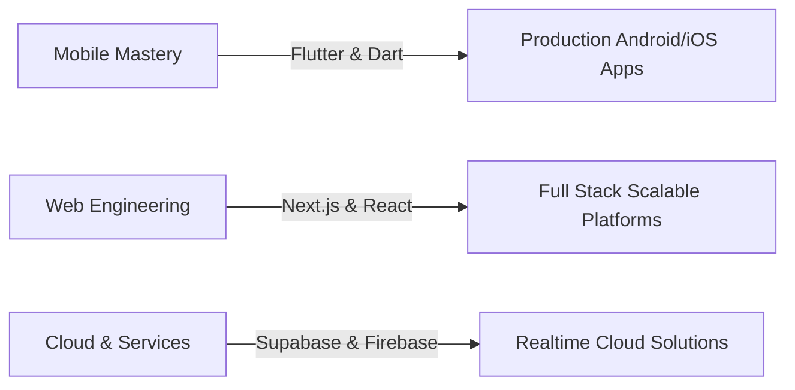

<!-- 🌟 Fahry Aditya Setiawan - Mobile Apps & Full Stack Web Developer Profile -->

# Fahry Aditya Setiawan | Mobile App Developer & Full Stack Web Developer

<!-- Animated Dynamic Header -->
<p align="center">
  
</p>

<!-- Avatar & Glassmorphism Status -->
<p align="center">
  <a href="https://fahry-portfolio.vercel.app/" target="_blank">
    
  </a>
</p>

<!-- Dynamic Animated Typing -->
<p align="center">
  
</p>

<!-- Social Badges & Contact Links -->
<p align="center">
  <a href="https://github.com/FahryAditya" target="_blank" rel="noopener noreferrer">
    
  </a>
  <a href="https://fahry-portfolio.vercel.app/" target="_blank" rel="noopener noreferrer">
    
  </a>
  <a href="https://www.instagram.com/miminadresteia?igsh=MWJzZmp6c2pyeGwyZQ==" target="_blank" rel="noopener noreferrer">
    
  </a>
  <a href="https://www.tiktok.com/@cassandra.id" target="_blank" rel="noopener noreferrer">
    
  </a>
  
</p>

<p align="center">
  
</p>

## 👨‍💻 About Me & Professional Summary

Halo dunia! 🚀 Saya **Fahry Aditya Setiawan** (dikenal juga sebagai **Mimin Cassandra**), seorang **Mobile Apps Developer** dan **Full Stack Web Developer** asal Indonesia 🇮🇩 dengan passion tinggi dalam membangun software yang cepat, scalable, dan berorientasi pengguna.

Saya berspesialisasi dalam ekosistem **Flutter & Dart** untuk aplikasi mobile lintas platform, arsitektur modern web menggunakan **Next.js, React, & TypeScript**, serta perancangan backend RESTful API yang handal.

```yaml
personal_info:
  full_name: Fahry Aditya Setiawan
  known_as: Mimin Cassandra
  location: Indonesia 🇮🇩
  specialization: Mobile App Development & Full Stack Web Development
  target_roles: Mobile App Developer, Full Stack Web Developer, Frontend / Backend Engineer
  primary_tech_stack: Flutter, Dart, React, Next.js, TypeScript, JavaScript, Tailwind CSS, Node.js, Java, MySQL
  motto: "Code is where logic meets imagination and seamless user experience"
```

### 💡 Core Competencies & What I Do

- 📱 **Cross-Platform Mobile Apps**: Mengembangkan aplikasi Android & iOS responsif dengan Flutter, Dart, arsitektur modular, state management (Bloc / Provider), dan Firebase.
- 🌐 **Modern Full Stack Web**: Merancang website responsif dan web app interaktif dengan Next.js, React, Tailwind CSS, TypeScript, dan SEO optimization.
- ⚙️ **Backend & Database Architecture**: Mendesain sistem API performa tinggi, autentikasi aman, dan manajemen database (MySQL, PostgreSQL, Supabase).
- 🤖 **IoT & Hardware Integration**: Menghubungkan aplikasi mobile/web dengan perangkat cerdas (Arduino, IoT microcontrollers).

<p align="center">
  
</p>

## 🏆 Key Achievements & Milestones

<table align="center" width="100%">
  <tr>
    <td align="center" width="25%">
      <br/>
      <b>📱 Cross-Platform Apps</b><br/>
      <sub>Flutter, Dart & Android UI</sub>
    </td>
    <td align="center" width="25%">
      <br/>
      <b>🌐 Modern Web Apps</b><br/>
      <sub>Next.js, React & Tailwind</sub>
    </td>
    <td align="center" width="25%">
      <br/>
      <b>⚡ High Performance APIs</b><br/>
      <sub>Node.js, Java & Databases</sub>
    </td>
    <td align="center" width="25%">
      <br/>
      <b>🎨 Design to Code</b><br/>
      <sub>Mobile-First Responsive</sub>
    </td>
  </tr>
</table>

<p align="center">
  
</p>

## 🛠️ Tech Arsenal & Frameworks

### 📱 Mobile & Core Languages

<p align="center">
  
</p>

### 🌐 Frontend & Web Ecosystem

<p align="center">
  
</p>

### ⚙️ Backend, Databases & Cloud

<p align="center">
  
</p>

### 🧰 Tools, DevOps & Workflows

<p align="center">
  
</p>

<p align="center">
  
</p>

## 🚀 Featured Showcase & Projects

<div align="center">

| 🎯 Domain                                       |                             📊 Project Status                              | 🔗 Primary Focus                   |
| :---------------------------------------------- | :------------------------------------------------------------------------: | :--------------------------------- |
| 📱 **Mobile Applications (Flutter / Android)**  |      | Cross-Platform Apps & Mobile UI    |
| 🌐 **Modern Web Development (Next.js / React)** |  | High Performance Web Applications  |
| ⚙️ **Backend & Database Architecture**          |         | RESTful API & Database Integration |
| 🤖 **IoT & Embedded Robotics**                  |   | Smart Automation & Controllers     |

</div>

<br/>

<!-- Featured GitHub Cards -->
<div align="center">
  <a href="https://fahry-portfolio.vercel.app/" target="_blank">
    
  </a>
</div>

### 📌 Project Highlights

- **🌐 Fahry Aditya Official Portfolio Website**
  - Website portofolio interaktif ultra-responsif dengan dukungan tema dinamis, arsitektur modern, dan optimasi SEO Google.
  - _Live Preview_: [fahry-portfolio.vercel.app](https://fahry-portfolio.vercel.app/)
  - _Tech_: Next.js, React, Tailwind CSS, TypeScript, Vercel.

- **📱 Flutter Cross-Platform Mobile Applications**
  - Aplikasi mobile modular dengan performa 60fps, transisi halus, konsumsi API efisien, dan offline-first capability.
  - _Tech_: Flutter, Dart, REST API, Firebase Auth & Firestore.

- **⚙️ Full Stack Cloud-Integrated Web Services**
  - Platform web dinamis dengan sistem manajemen role pengguna, database relasional teroptimasi, dan keamanan data.
  - _Tech_: Node.js, Express, MySQL, Next.js, Supabase.

<p align="center">
  
</p>

## 📊 GitHub Analytics & Code Stats

<div align="center">
  
  
</div>

<br/>

<div align="center">
  
</div>

<br/>

<!-- Contribution Activity Graph -->
<div align="center">
  
</div>

<p align="center">
  
</p>

## 🎯 Engineering Roadmap & Vision



### 📋 Current Sprint Goals

- [x] Building high-converting responsive web apps with Next.js & Tailwind CSS
- [x] Integrating robust REST APIs & JWT Authentication
- [ ] Developing advanced Flutter mobile apps with Bloc Pattern
- [ ] Automated CI/CD Pipelines & Cloud Containerization
- [ ] Releasing cross-platform apps to App Store & Google Play

<p align="center">
  
</p>

## 💬 Dev Mindset & Daily Inspiration

<div align="center">
  
</div>

<p align="center">
  
</p>

## 🤝 Let's Connect & Collaborate!

Saya selalu bersemangat untuk berkolaborasi dalam pembuatan **aplikasi mobile**, **website modern**, proyek open-source, atau peluang kerja sama teknologi lainnya.

<p align="center">
  <a href="https://github.com/FahryAditya" target="_blank" rel="noopener noreferrer">
    
  </a>
  <a href="https://fahry-portfolio.vercel.app/" target="_blank" rel="noopener noreferrer">
    
  </a>
  <a href="https://www.instagram.com/miminadresteia?igsh=MWJzZmp6c2pyeGwyZQ==" target="_blank" rel="noopener noreferrer">
    
  </a>
  <a href="https://www.tiktok.com/@cassandra.id" target="_blank" rel="noopener noreferrer">
    
  </a>
</p>

<p align="center">
  
  
  
</p>

<p align="center">
  
</p>

<!-- Snake Contribution Game Animation -->
<div align="center">
  
</div>

<p align="center">
  
</p>

<!-- Custom Footer Showcase Banner -->
<p align="center">
  
</p>

<p align="center">
  <sub>Designed & Engineered with 💙 by <b>Fahry Aditya Setiawan (Mimin Cassandra)</b></sub><br/>
  <sub>Mobile App Developer • Full Stack Web Developer • Indonesia</sub>
</p>
